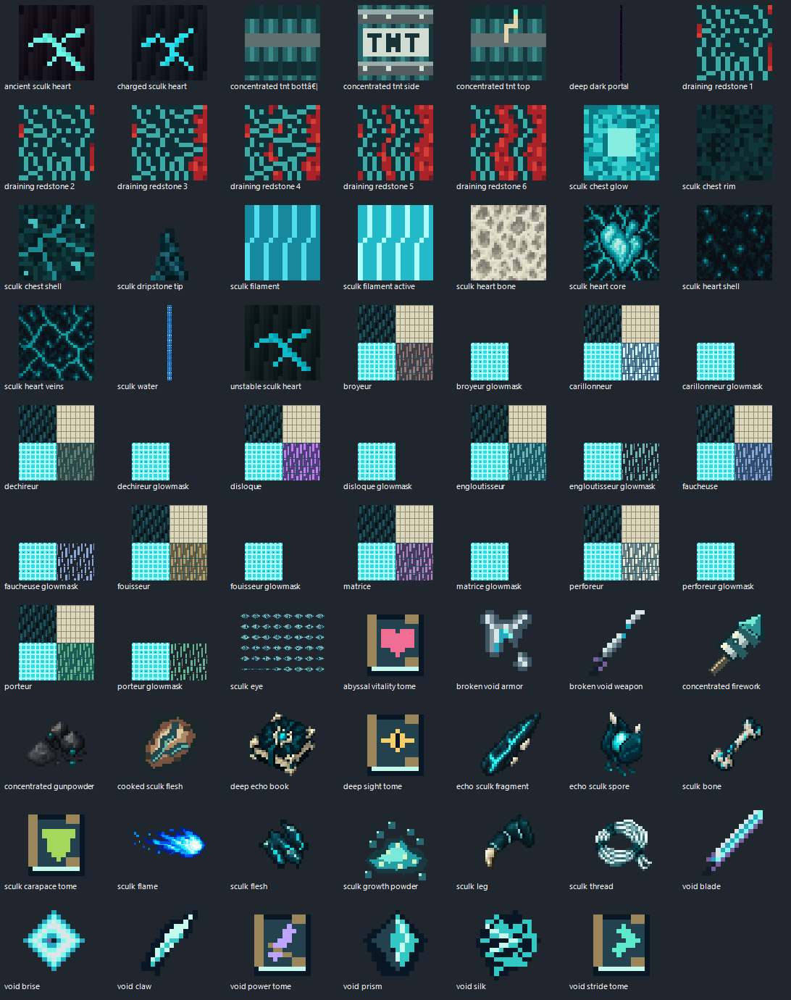

# Deep Dark Rising — Wiki

> Statut : documentation locale, prête à publier.
> Fichiers universels locaux Deep Dark Rising 0.1.0 pour Minecraft 26.x et 1.21.x inspectés en lecture seule, y compris leurs sous-JARs. Les comportements décrits restent à confirmer en jeu.

Une expansion du Deep Dark dans laquelle le sculk se propage et un portail mène à un monde dévasté.

**CurseForge :** https://www.curseforge.com/minecraft/mc-mods/deepdark-void-a-fabric-expansion-of-the-deep-dark

**Type :** fabric · **Archive :** 0.1.0, universal MC 1.21 and MC 26.

## Sommaire

- [Accueil](docs/Accueil.md)
- [Installation](docs/Installation.md)
- [Guide et mécaniques](docs/Fonctionnement.md)
- [FAQ](docs/FAQ.md)
- [Inventaire des archives JAR/ZIP](docs/Inventaire-JAR.md)
- [Sources et limites](docs/Sources-et-verification.md)
- [English overview](docs/English-Overview.md)

Télécharge les fichiers d'installation directement sur CurseForge. Les JAR, ZIP et textures ne sont pas redistribués dans ce wiki.

## Ressources réelles extraites des archives

Les fichiers JAR/ZIP du mod ont été inspectés sans être exécutés. Les pages suivantes présentent les recettes JSON, fonctions, traductions, structures et textures effectivement présentes dans la version indiquée.

- [Atlas technique : versions, structures, butin](docs/Atlas-technique.md)
- [Recettes et crafts du JAR](docs/Recettes-verifiees.md)
- [Objets, blocs, entités et enchantements](docs/Objets-blocs-entites.md)
- [Galerie des textures PNG du mod](docs/Textures-originales.md)
- [Fonctions et règles statiques](docs/Fonctions-analysees.md)

**Référence :** `deep-dark-rising-0.1.0-mc1.21-universal.jar`, module `META-INF/jars/deep-dark-rising-0.1.0-mc1.21.11.jar`.

### Aperçu des textures originales

Les fichiers PNG sont extraits du JAR du mod. La planche illustre les ressources brutes, pas l'apparence définitive des blocs et entités dans Minecraft.
