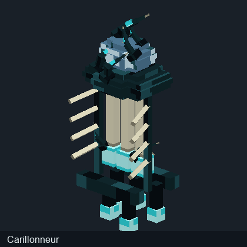
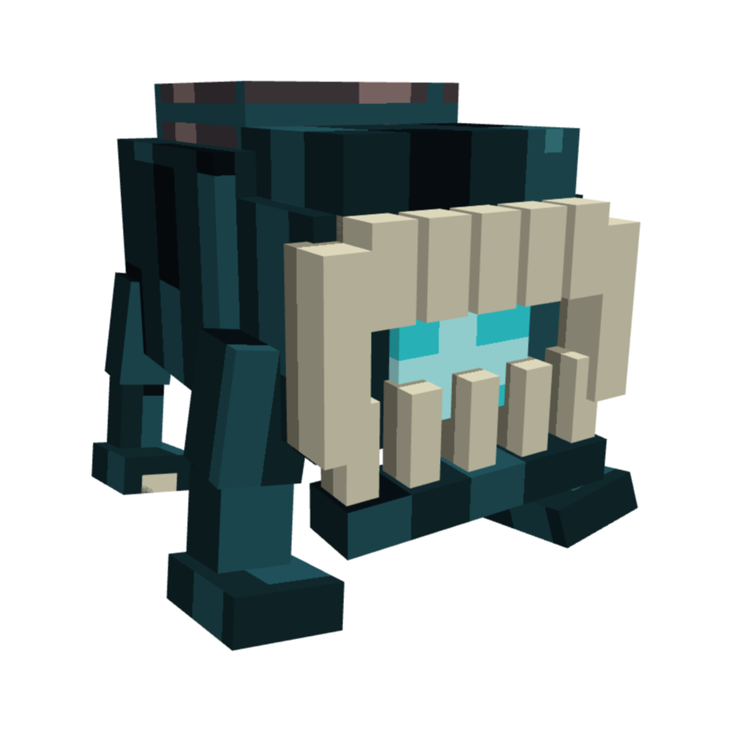

# Diagnostic des textures 3D — Deep Dark Rising

Les images initiales n'avaient pas toutes les coordonnées UV correctes. Les aperçus mis à jour utilisent toujours les géométries du JAR audité, mais corrigent le traitement des textures.

## Erreurs vérifiées

- Dans Minecraft Java, les UV des modèles de blocs sont exprimées dans un espace de référence 16 × 16. Un PNG 32 × 32 exige donc de multiplier les coordonnées UV par deux, au lieu de n'utiliser que son quart supérieur gauche.

- Le dépliage des cubes GeckoLib utilise l'ordre est, nord, ouest, sud, pas l'inversion des faces latérales employée par le premier convertisseur.

- Les inversions et les rotations UV sont désormais traitées. Les textures PNG d'origine ne sont pas redessinées.

## Comparaison de la même géométrie JAR

Les modèles de la colonne de gauche sont les anciens aperçus UV1 conservés pour vérification; les modèles de droite sont les nouveaux aperçus UV2.

| Modèle | Avant : projection incorrecte | Après : UV corrigées |

| --- | --- | --- |

| bloc ancient sculk heart |  |  |

| entite broyeur |  |  |

| entite carillonneur |  |  |

## Autre différence : modèles Blockbench historiques et modèles JAR

Les archives locales de travail contiennent un modèle Blockbench historique du Broyeur comportant 34 cubes. Le JAR 1.21.11 analysé pour le wiki contient un Broyeur à 177 cubes. La texture broyeur.png est identique octet pour octet dans les deux archives (SHA-256 : 3e515451a74e2fd5f19b3dfc52637d08d139d499fad7bdf1be873ba0a4490109). La différence de silhouette provient donc bien d'une géométrie différente et ne peut pas être résolue en changeant les couleurs PNG.

| Modèle Blockbench antérieur | Modèle présent dans le JAR |

| --- | --- |

|  |  |

Les autres archives Blockbench retrouvées montrent également des différences de nombres de cubes (Carillonneur : 22 contre 118 ; Déchireur : 126 contre 268). La galerie principale décrit les fichiers du JAR, pas les modèles historiques.

## Limites importantes

Les rendus logiciels ne sont pas des captures de Minecraft : animations, UV de couches secondaires, éclairage émissif, rotations par blockstates et effets de rendu Java peuvent être différents. Les images ne sont plus de simples PNG dépliés, mais un contrôle dans Blockbench ou Minecraft reste nécessaire pour assurer la correspondance parfaite.

[Galerie des modèles 3D](Modeles-3D.md) · [Accueil](../README.md)
