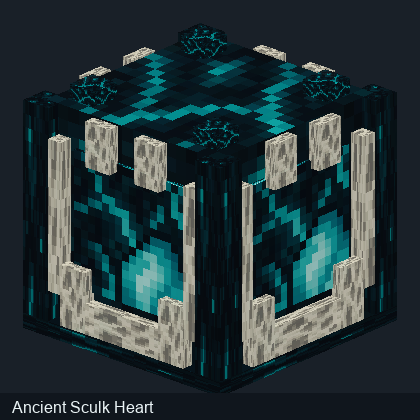
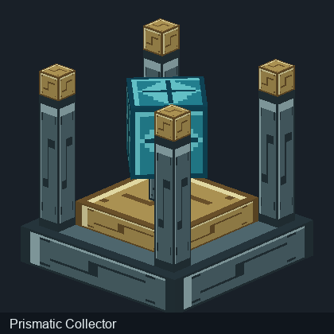

# Corrections des aperçus de blocs

Une précédente génération d'aperçus 3D appliquait mal certaines UV sur les blocs Minecraft. Dans les modèles Java, les UV sont référencées à un espace 16 × 16 et doivent être adaptées à la résolution réelle du PNG.

Les images des **blocs** ont été recalculées, puis les anciens aperçus ont été conservés à des fins de comparaison. Cette page technique ne présente aucune créature.

| Bloc | Ancien aperçu | Aperçu corrigé |
|---|---|---|
| Cœur ancien |  |  |
| Collecteur prismatique |  |  |

Ce sont des aperçus logiciels issus des modèles de blocs du JAR, pas des captures du moteur Minecraft. Les comparaisons d'entités et leurs géométries ne sont plus diffusées dans le wiki.

[Guide des blocs](Modeles-3D.md) · [Accueil](../README.md)
