# Modèles 3D — Deep Dark Rising

**Ces images montrent les véritables formes 3D reconstruites à partir des modèles contenus dans les JARs et de leurs coordonnées UV.** Ce ne sont plus les planches de textures brutes.

L'aperçu utilise une caméra isométrique, une pose de repos et un éclairage logiciel. Il ne représente pas une capture d'écran de Minecraft : les animations, les shaders, les couches émissives et certaines rotations peuvent varier en jeu.

Les fichiers de modèle natifs extraits du JAR restent accessibles à côté des images ; aucun modèle n'a été inventé à partir du PNG seul.

## Les entités (géométrie GeckoLib)

Pour chaque créature, l'image représente ses véritables cubes et os en pose de repos. Le fichier <code>.geo.json</code> et la texture PNG d'origine peuvent être ouverts dans Blockbench avec le format adapté.

| Aperçu rendu en 3D | Entité / fichiers natifs | Géométrie |
| --- | --- | --- |

| <a href="../assets/modeles_3d/entite_broyeur.png">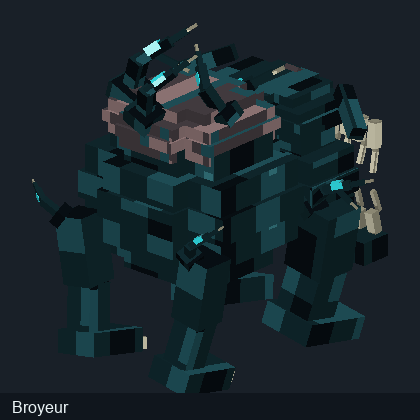</a> | **Broyeur** · [Modèle GeckoLib original](../assets/modeles_3d/geometries/broyeur.geo.json) · [Texture UV originale](../assets/modeles_3d/textures_entites/broyeur.png) | 34 os · 177 cubes |

| <a href="../assets/modeles_3d/entite_carillonneur.png">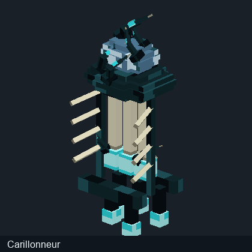</a> | **Carillonneur** · [Modèle GeckoLib original](../assets/modeles_3d/geometries/carillonneur.geo.json) · [Texture UV originale](../assets/modeles_3d/textures_entites/carillonneur.png) | 30 os · 118 cubes |

| <a href="../assets/modeles_3d/entite_dechireur.png">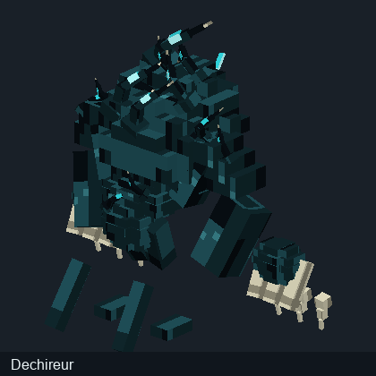</a> | **Dechireur** · [Modèle GeckoLib original](../assets/modeles_3d/geometries/dechireur.geo.json) · [Texture UV originale](../assets/modeles_3d/textures_entites/dechireur.png) | 47 os · 268 cubes |

| <a href="../assets/modeles_3d/entite_disloque.png">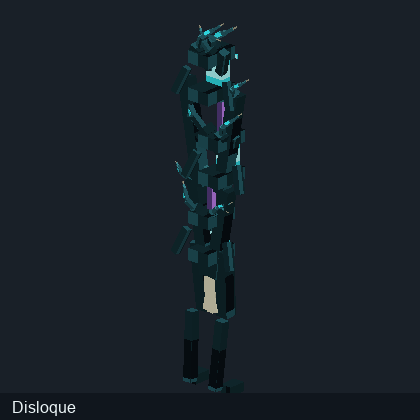</a> | **Disloque** · [Modèle GeckoLib original](../assets/modeles_3d/geometries/disloque.geo.json) · [Texture UV originale](../assets/modeles_3d/textures_entites/disloque.png) | 37 os · 99 cubes |

| <a href="../assets/modeles_3d/entite_engloutisseur.png">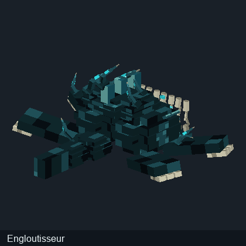</a> | **Engloutisseur** · [Modèle GeckoLib original](../assets/modeles_3d/geometries/engloutisseur.geo.json) · [Texture UV originale](../assets/modeles_3d/textures_entites/engloutisseur.png) | 33 os · 195 cubes |

| <a href="../assets/modeles_3d/entite_faucheuse.png">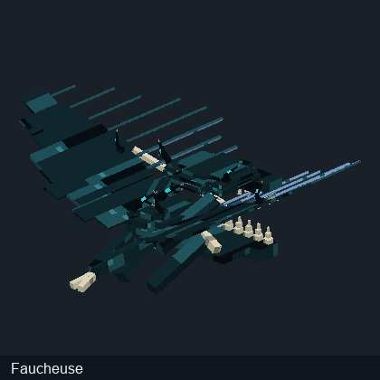</a> | **Faucheuse** · [Modèle GeckoLib original](../assets/modeles_3d/geometries/faucheuse.geo.json) · [Texture UV originale](../assets/modeles_3d/textures_entites/faucheuse.png) | 55 os · 187 cubes |

| <a href="../assets/modeles_3d/entite_fouisseur.png">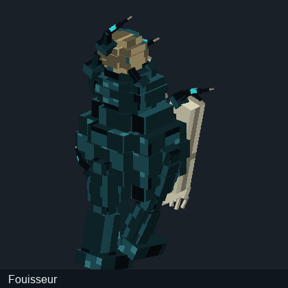</a> | **Fouisseur** · [Modèle GeckoLib original](../assets/modeles_3d/geometries/fouisseur.geo.json) · [Texture UV originale](../assets/modeles_3d/textures_entites/fouisseur.png) | 34 os · 220 cubes |

| <a href="../assets/modeles_3d/entite_matrice.png">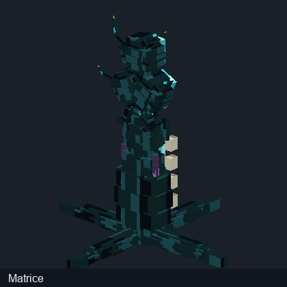</a> | **Matrice** · [Modèle GeckoLib original](../assets/modeles_3d/geometries/matrice.geo.json) · [Texture UV originale](../assets/modeles_3d/textures_entites/matrice.png) | 37 os · 245 cubes |

| <a href="../assets/modeles_3d/entite_perforeur.png">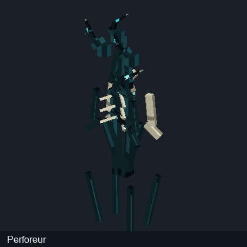</a> | **Perforeur** · [Modèle GeckoLib original](../assets/modeles_3d/geometries/perforeur.geo.json) · [Texture UV originale](../assets/modeles_3d/textures_entites/perforeur.png) | 34 os · 105 cubes |

| <a href="../assets/modeles_3d/entite_porteur.png">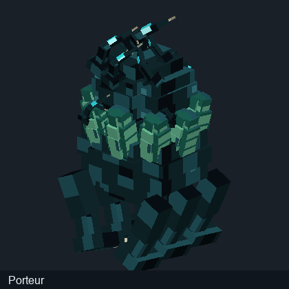</a> | **Porteur** · [Modèle GeckoLib original](../assets/modeles_3d/geometries/porteur.geo.json) · [Texture UV originale](../assets/modeles_3d/textures_entites/porteur.png) | 44 os · 264 cubes |

| <a href="../assets/modeles_3d/entite_sangsue.png">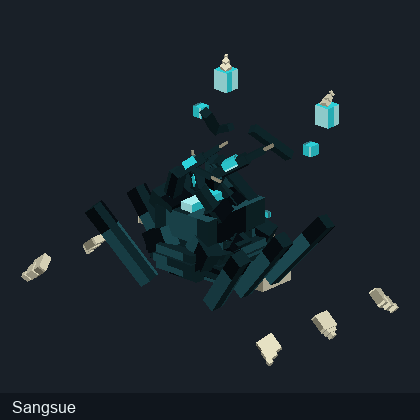</a> | **Sangsue** · [Modèle GeckoLib original](../assets/modeles_3d/geometries/sangsue.geo.json) · [Texture UV originale](../assets/modeles_3d/textures_entites/sangsue.png) | 35 os · 117 cubes |

| <a href="../assets/modeles_3d/entite_void_brood.png">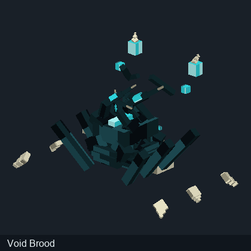</a> | **Void Brood** · [Modèle GeckoLib original](../assets/modeles_3d/geometries/void_brood.geo.json) · [Texture UV originale](../assets/modeles_3d/textures_entites/void_brood.png) | 35 os · 117 cubes |

| <a href="../assets/modeles_3d/entite_void_devourer.png">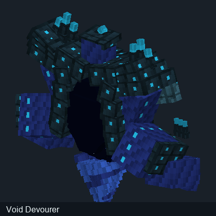</a> | **Void Devourer** · [Modèle GeckoLib original](../assets/modeles_3d/geometries/void_devourer.geo.json) · [Texture UV originale](../assets/modeles_3d/textures_entites/void_devourer.png) | 288 os · 454 cubes |

| <a href="../assets/modeles_3d/entite_void_oracle.png">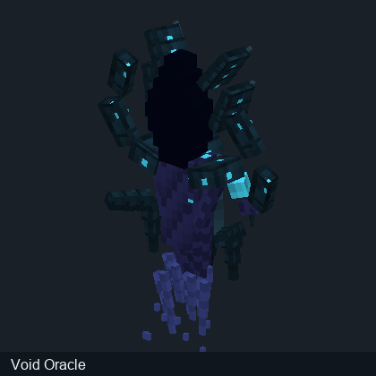</a> | **Void Oracle** · [Modèle GeckoLib original](../assets/modeles_3d/geometries/void_oracle.geo.json) · [Texture UV originale](../assets/modeles_3d/textures_entites/void_oracle.png) | 90 os · 198 cubes |

| <a href="../assets/modeles_3d/entite_void_stalker.png">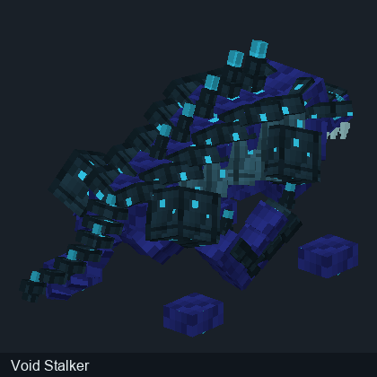</a> | **Void Stalker** · [Modèle GeckoLib original](../assets/modeles_3d/geometries/void_stalker.geo.json) · [Texture UV originale](../assets/modeles_3d/textures_entites/void_stalker.png) | 121 os · 275 cubes |

| <a href="../assets/modeles_3d/entite_void_walker.png">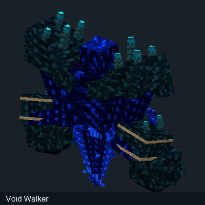</a> | **Void Walker** · [Modèle GeckoLib original](../assets/modeles_3d/geometries/void_walker.geo.json) · [Texture UV originale](../assets/modeles_3d/textures_entites/void_walker.png) | 210 os · 347 cubes |

| <a href="../assets/modeles_3d/entite_void_weaver.png">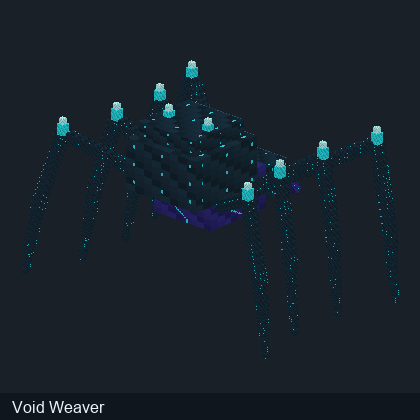</a> | **Void Weaver** · [Modèle GeckoLib original](../assets/modeles_3d/geometries/void_weaver.geo.json) · [Texture UV originale](../assets/modeles_3d/textures_entites/void_weaver.png) | 11 os · 367 cubes |

| <a href="../assets/modeles_3d/entite_vrille.png">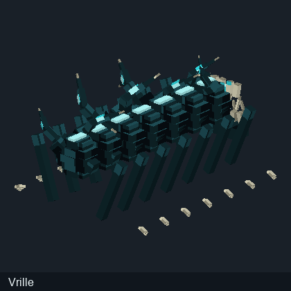</a> | **Vrille** · [Modèle GeckoLib original](../assets/modeles_3d/geometries/vrille.geo.json) · [Texture UV originale](../assets/modeles_3d/textures_entites/vrille.png) | 59 os · 266 cubes |

**Animations :** les fichiers GeckoLib trouvés dans le JAR sont disponibles dans le dossier [animations](../assets/modeles_3d/animations/README.md) quand présents. Ils ne sont pas joués dans ces vignettes.

## Blocs — modèles JSON Minecraft

| Aperçu rendu en 3D | Bloc / modèle JSON | Eléments |
| --- | --- | ---: |

| <a href="../assets/modeles_3d/bloc_ancient_sculk_heart.png">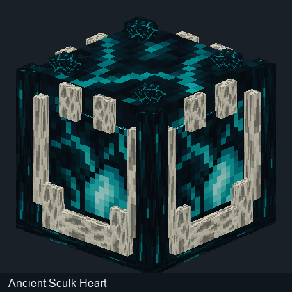</a> | **Ancient Sculk Heart** · [Modèle de bloc d'origine](../assets/modeles_3d/modeles_blocs/ancient_sculk_heart.json) | 42 |

| <a href="../assets/modeles_3d/bloc_charged_sculk_heart.png">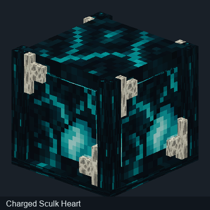</a> | **Charged Sculk Heart** · [Modèle de bloc d'origine](../assets/modeles_3d/modeles_blocs/charged_sculk_heart.json) | 26 |

| <a href="../assets/modeles_3d/bloc_concentrated_tnt.png">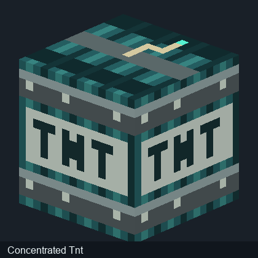</a> | **Concentrated Tnt** · [Modèle de bloc d'origine](../assets/modeles_3d/modeles_blocs/concentrated_tnt.json) | 1 |

| <a href="../assets/modeles_3d/bloc_prismatic_collector.png">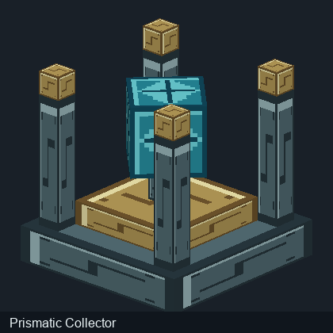</a> | **Prismatic Collector** · [Modèle de bloc d'origine](../assets/modeles_3d/modeles_blocs/prismatic_collector.json) | 12 |

| <a href="../assets/modeles_3d/bloc_sculk_confinement.png">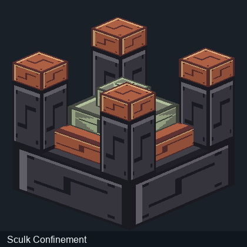</a> | **Sculk Confinement** · [Modèle de bloc d'origine](../assets/modeles_3d/modeles_blocs/sculk_confinement.json) | 12 |

| <a href="../assets/modeles_3d/bloc_unstable_sculk_heart.png">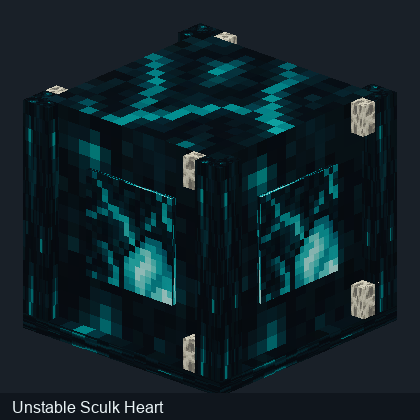</a> | **Unstable Sculk Heart** · [Modèle de bloc d'origine](../assets/modeles_3d/modeles_blocs/unstable_sculk_heart.json) | 18 |

## Pourquoi conserver également les textures à plat ?

Le rendu en 3D sert à comprendre l'apparence d'un bloc ou d'une créature. Les planches UV sont utiles aux créateurs de mods qui souhaitent vérifier l'application des textures et modifier les ressources. Les deux vues ont donc des utilités différentes.

[Retour au wiki](../README.md) · [Textures UV brutes](Textures-originales.md) · [Recettes](Recettes-verifiees.md)
