# Galerie des textures extraites — Deep Dark Rising
**Analyse statique d'une archive locale** : les images ci-dessous sont des fichiers PNG originaux extraits du namespace propre au mod. Aucun rendu 3D en jeu n'est garanti par la présence de ces textures.
Archive de référence : `deep-dark-rising-0.1.0-mc1.21-universal.jar` ; module : `META-INF/jars/deep-dark-rising-0.1.0-mc1.21.11.jar` ; variante `1.21.11`.
Toutes les textures présentes dans le JAR ne sont pas reproduites : sélection de textures illustratives ; les originaux du mod ne sont pas modifiés.
## Planche d'aperçu en images

Cette planche rassemble les textures réelles du mod, agrandies avec interpolation au plus proche. Ce ne sont pas des captures de Minecraft ni des rendus de modèles 3D.

## Blocs
| Texture | Nom de fichier | Format PNG |
| --- | --- | --- |
|  | `block/ancient_sculk_heart` | 16 × 16 |
|  | `block/charged_sculk_heart` | 16 × 16 |
|  | `block/deep_dark_portal` | 16 × 512 |
|  | `block/sculk_chest_glow` | 16 × 16 |
|  | `block/sculk_chest_rim` | 16 × 16 |
|  | `block/sculk_chest_shell` | 16 × 16 |
|  | `block/sculk_dripstone_tip` | 16 × 16 |
|  | `block/sculk_filament` | 16 × 16 |
|  | `block/sculk_filament_active` | 16 × 16 |
| <a href="../assets/textures/block/sculk_heart_bone.png">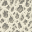</a> | `block/sculk_heart_bone` | 32 × 32 |
|  | `block/sculk_heart_core` | 32 × 32 |
| <a href="../assets/textures/block/sculk_heart_shell.png">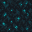</a> | `block/sculk_heart_shell` | 32 × 32 |
| <a href="../assets/textures/block/sculk_heart_veins.png">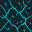</a> | `block/sculk_heart_veins` | 32 × 32 |
|  | `block/sculk_water` | 16 × 256 |
|  | `block/unstable_sculk_heart` | 16 × 16 |
| <a href="../assets/textures/block/concentrated_tnt_bottom.png">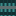</a> | `block/concentrated_tnt_bottom` | 16 × 16 |
|  | `block/concentrated_tnt_side` | 16 × 16 |
| <a href="../assets/textures/block/concentrated_tnt_top.png">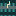</a> | `block/concentrated_tnt_top` | 16 × 16 |
| <a href="../assets/textures/block/draining_redstone_1.png">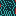</a> | `block/draining_redstone_1` | 16 × 16 |
| <a href="../assets/textures/block/draining_redstone_2.png">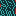</a> | `block/draining_redstone_2` | 16 × 16 |
| <a href="../assets/textures/block/draining_redstone_3.png">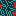</a> | `block/draining_redstone_3` | 16 × 16 |
|  | `block/draining_redstone_4` | 16 × 16 |
|  | `block/draining_redstone_5` | 16 × 16 |
|  | `block/draining_redstone_6` | 16 × 16 |
## Objets et équipements
| Texture | Nom de fichier | Format PNG |
| --- | --- | --- |
| <a href="../assets/textures/item/broken_void_armor.png">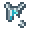</a> | `item/broken_void_armor` | 32 × 32 |
| <a href="../assets/textures/item/broken_void_weapon.png">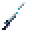</a> | `item/broken_void_weapon` | 32 × 32 |
| <a href="../assets/textures/item/cooked_sculk_flesh.png">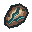</a> | `item/cooked_sculk_flesh` | 32 × 32 |
| <a href="../assets/textures/item/echo_sculk_fragment.png">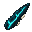</a> | `item/echo_sculk_fragment` | 32 × 32 |
| <a href="../assets/textures/item/echo_sculk_spore.png">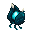</a> | `item/echo_sculk_spore` | 32 × 32 |
| <a href="../assets/textures/item/sculk_bone.png">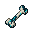</a> | `item/sculk_bone` | 32 × 32 |
|  | `item/sculk_carapace_tome` | 64 × 64 |
| <a href="../assets/textures/item/sculk_flame.png">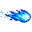</a> | `item/sculk_flame` | 64 × 64 |
| <a href="../assets/textures/item/sculk_flesh.png">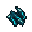</a> | `item/sculk_flesh` | 32 × 32 |
| <a href="../assets/textures/item/sculk_growth_powder.png">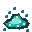</a> | `item/sculk_growth_powder` | 32 × 32 |
| <a href="../assets/textures/item/sculk_leg.png">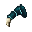</a> | `item/sculk_leg` | 32 × 32 |
| <a href="../assets/textures/item/sculk_thread.png">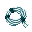</a> | `item/sculk_thread` | 32 × 32 |
| <a href="../assets/textures/item/void_blade.png">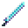</a> | `item/void_blade` | 32 × 32 |
| <a href="../assets/textures/item/void_brise.png">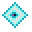</a> | `item/void_brise` | 32 × 32 |
| <a href="../assets/textures/item/void_claw.png">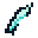</a> | `item/void_claw` | 64 × 64 |
| <a href="../assets/textures/item/void_power_tome.png">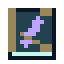</a> | `item/void_power_tome` | 64 × 64 |
| <a href="../assets/textures/item/void_prism.png">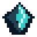</a> | `item/void_prism` | 64 × 64 |
| <a href="../assets/textures/item/void_silk.png">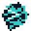</a> | `item/void_silk` | 64 × 64 |
| <a href="../assets/textures/item/void_stride_tome.png">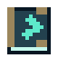</a> | `item/void_stride_tome` | 64 × 64 |
| <a href="../assets/textures/item/abyssal_vitality_tome.png">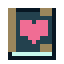</a> | `item/abyssal_vitality_tome` | 64 × 64 |
| <a href="../assets/textures/item/concentrated_firework.png">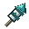</a> | `item/concentrated_firework` | 32 × 32 |
| <a href="../assets/textures/item/concentrated_gunpowder.png">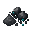</a> | `item/concentrated_gunpowder` | 32 × 32 |
| <a href="../assets/textures/item/deep_echo_book.png">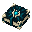</a> | `item/deep_echo_book` | 32 × 32 |
|  | `item/deep_sight_tome` | 64 × 64 |
## Entités et créatures
| Texture | Nom de fichier | Format PNG |
| --- | --- | --- |
| <a href="../assets/textures/entity/broyeur.png">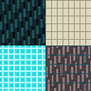</a> | `entity/broyeur` | 128 × 128 |
|  | `entity/broyeur_glowmask` | 128 × 128 |
| <a href="../assets/textures/entity/carillonneur.png">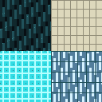</a> | `entity/carillonneur` | 128 × 128 |
|  | `entity/carillonneur_glowmask` | 128 × 128 |
| <a href="../assets/textures/entity/dechireur.png">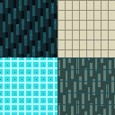</a> | `entity/dechireur` | 128 × 128 |
|  | `entity/dechireur_glowmask` | 128 × 128 |
| <a href="../assets/textures/entity/disloque.png">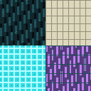</a> | `entity/disloque` | 128 × 128 |
|  | `entity/disloque_glowmask` | 128 × 128 |
| <a href="../assets/textures/entity/engloutisseur.png">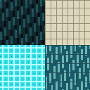</a> | `entity/engloutisseur` | 128 × 128 |
| <a href="../assets/textures/entity/engloutisseur_glowmask.png">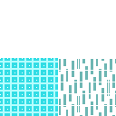</a> | `entity/engloutisseur_glowmask` | 128 × 128 |
| <a href="../assets/textures/entity/faucheuse.png">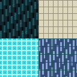</a> | `entity/faucheuse` | 128 × 128 |
| <a href="../assets/textures/entity/faucheuse_glowmask.png">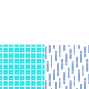</a> | `entity/faucheuse_glowmask` | 128 × 128 |
| <a href="../assets/textures/entity/fouisseur.png">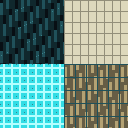</a> | `entity/fouisseur` | 128 × 128 |
| <a href="../assets/textures/entity/fouisseur_glowmask.png">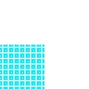</a> | `entity/fouisseur_glowmask` | 128 × 128 |
| <a href="../assets/textures/entity/matrice.png">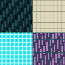</a> | `entity/matrice` | 128 × 128 |
|  | `entity/matrice_glowmask` | 128 × 128 |
| <a href="../assets/textures/entity/perforeur.png">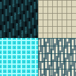</a> | `entity/perforeur` | 128 × 128 |
|  | `entity/perforeur_glowmask` | 128 × 128 |
| <a href="../assets/textures/entity/porteur.png">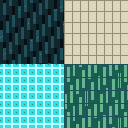</a> | `entity/porteur` | 128 × 128 |
| <a href="../assets/textures/entity/porteur_glowmask.png">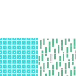</a> | `entity/porteur_glowmask` | 128 × 128 |
## Autres textures
| Texture | Nom de fichier | Format PNG |
| --- | --- | --- |
| <a href="../assets/textures/environment/celestial/sculk_eye.png">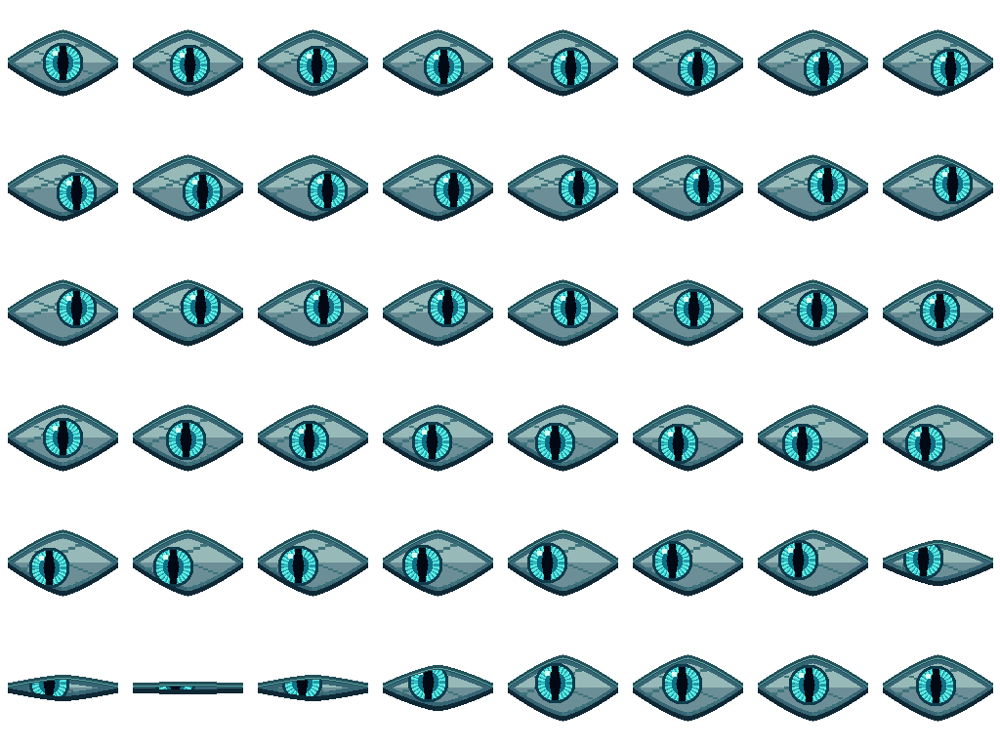</a> | `environment/celestial/sculk_eye` | 1024 × 768 |
## Origine et limites

Ces PNG proviennent uniquement du dossier `assets/deep_dark_rising/textures/` du module de référence. Ils ne prouvent ni le rendu final, ni les recettes associées. Les textures de Minecraft vanilla et les bibliothèques tierces sont exclues de la galerie.
